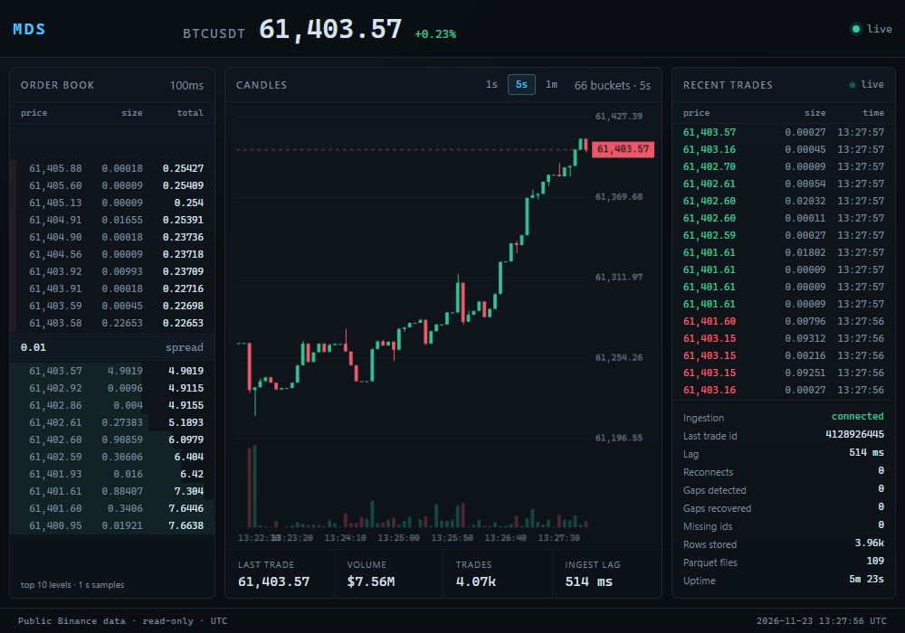

# market-data-service

A read-only market data service that ingests Binance spot data in real time,
stores it as a partitioned Parquet lake and serves it through a FastAPI HTTP
API, a live WebSocket and a small browser dashboard.



The dashboard is served by the service itself. The screenshot above is a real
capture of a local run streaming `BTCUSDT`, with the 5-second interval selected.

## What it does

- Subscribes to `<symbol>@aggTrade` and `<symbol>@depth@100ms` over one
  combined WebSocket connection.
- Normalizes every message into an explicit schema with UTC timestamps and
  `decimal128(38, 12)` prices.
- Writes trades and sampled order book snapshots to Parquet, partitioned by
  symbol and UTC date, with size- and time-based rotation.
- Repairs gaps in the trade id sequence through the public REST endpoint after
  a disconnect or a dropped frame.
- Rebuilds the local order book from a REST snapshot after every reconnect and
  whenever a diff update breaks contiguity.
- Answers latest price, OHLCV candles and ingestion status through FastAPI,
  using DuckDB over the Parquet files.
- Streams trades, candles and top-of-book updates to the dashboard over
  `/ws`.
- Exposes Prometheus metrics for throughput, lag, reconnects, gaps and storage.
- Starts with `docker compose up`, with the data and metrics in named volumes.

Only public endpoints are used. The service cannot place orders, does not need
API keys and never writes to the exchange.

## Quick start

```bash
git clone https://github.com/IkerAbad/market-data-service.git
cd market-data-service
docker compose up --build
```

| Service | URL |
|---|---|
| Dashboard | <http://localhost:8000> |
| OpenAPI docs | <http://localhost:8000/docs> |
| Prometheus | <http://localhost:9090> |

To ingest another symbol:

```bash
MDS_SYMBOL=ETHUSDT docker compose up --build
```

`docker compose down` keeps both volumes. `docker compose down -v` deletes the
Parquet lake and the Prometheus database.

## Local development

Python 3.12 is required.

```powershell
py -3.12 -m venv .venv
.\.venv\Scripts\Activate.ps1
pip install -e ".[dev]"
python -m market_data_service
```

On Linux or macOS, replace the activation line with
`source .venv/bin/activate`.

By default the data goes to `./data` and the API listens on port 8000. The
service starts ingesting immediately; after a few seconds the dashboard has
candles, trades and a book.

## Repository layout

```text
src/market_data_service/
├── config.py       environment settings
├── models.py       normalized records
├── parser.py       strict Binance payload validation
├── ingestion.py    WebSocket loop, backoff, gap detection, backfill
├── depth.py        order book state machine and resync
├── aggregator.py   in-memory OHLCV for the live feed
├── storage.py      partitioned Parquet writer and rotation
├── query.py        DuckDB analytics
├── pipeline.py     fan-out: lake, candles, WebSocket, metrics
├── api.py          REST, WebSocket and static dashboard
└── static/         HTML, CSS and JavaScript, no framework

tests/
├── fake_exchange.py          fake WebSocket + REST exchange
├── fixtures/agg_trades.jsonl messages replayed by the fake exchange
├── test_parser.py             normalization and validation
├── test_aggregator.py         OHLCV and bucket boundaries
├── test_storage.py            partitions, schema, rotation
├── test_query.py              DuckDB queries
├── test_depth.py              snapshot anchoring and resync
├── test_api.py                HTTP and WebSocket API
└── test_integration_gap.py    five-second network cut, end to end
```

## Data model

Full schema, invariants and query examples: [docs/schema.md](docs/schema.md).

```text
data/trades/symbol=BTCUSDT/date=2026-11-23/part-*.parquet
data/book/symbol=BTCUSDT/date=2026-11-23/part-*.parquet
```

| Dataset | Granularity | Key columns |
|---|---|---|
| `trades` | one aggregate trade | `trade_id`, `price`, `quantity`, `trade_time` |
| `book` | one price level per 1 s sample | `last_update_id`, `side`, `level`, `price` |

Prices and quantities are `decimal128(38, 12)`, timestamps are
`timestamp[us, UTC]`, and `quote_quantity` is derived without floats. Files are
rotated at 50 000 rows, 64 MiB or 5 seconds, whichever comes first.

## Ingestion and recovery

The trade stream is ordered by aggregate trade id. If an inbound id is not
exactly `last + 1`, the service:

1. counts the discontinuity in `mds_gaps_detected_total`,
2. buffers live trades while it requests `GET /api/v3/aggTrades?fromId=...`,
3. writes the recovered ids in order, then drains the live buffer,
4. reports any id that REST could not supply through
   `mds_trades_missing_total` instead of hiding it.

A reconnect triggers the same path, and the order book is rebuilt from a fresh
REST snapshot before it is used again. Reconnection uses exponential backoff
with equal jitter: `delay = min(cap, base * 2^attempt) / 2 + U(0, delay / 2)`.

The integration test `test_five_second_cut_is_backfilled_without_gaps` proves
the behavior end to end. A fake exchange replays
`tests/fixtures/agg_trades.jsonl`: it sends 20 trades, closes the socket, refuses
connections for five seconds and resumes at trade 26. Trades 21 to 25 are only
obtainable through REST. The test checks that:

- the outage lasted at least five seconds,
- five trades were recovered with `trades_backfilled == 5`,
- no id is missing,
- the Parquet lake contains exactly ids 1 to 45, without duplicates or holes.

Run only that test with:

```bash
pytest -m integration -q
```

## API

| Method | Path | Description |
|---|---|---|
| `GET` | `/api/v1/health` | Liveness, ingestion and book readiness |
| `GET` | `/api/v1/price?symbol=BTCUSDT` | Latest trade |
| `GET` | `/api/v1/candles?interval=1m&limit=200` | OHLCV, intervals `1s`, `5s`, `1m` |
| `GET` | `/api/v1/book?limit=20` | Current book, or the last snapshot from Parquet |
| `GET` | `/api/v1/status` | Ingestion, lag, gaps and storage counters |
| `GET` | `/metrics` | Prometheus exposition |
| `WS` | `/ws` | Live `trade`, `candle` and `book` frames |

Prices in JSON are strings, never floats:

```json
{
  "symbol": "BTCUSDT",
  "trade_id": 4128923445,
  "price": "61403.57",
  "quantity": "0.00027",
  "quote_quantity": "16.5789639",
  "trade_time": "2026-11-23T13:27:57Z",
  "ingested_at": "2026-11-23T13:27:57.031Z",
  "side": "buy"
}
```

Candles are computed by DuckDB from the trade files. The live aggregator is
merged on top, so the current bucket stays fresh between Parquet flushes. A
candle's `close_time` is exclusive.

The dashboard is plain HTML, CSS and JavaScript. It opens one WebSocket, renders
candles on a canvas, updates the book and the tape in place, and reconnects on
its own with backoff. No build step, no CDN, no framework.

## Metrics

| Metric | Type | Meaning |
|---|---|---|
| `mds_ws_messages_total{stream}` | counter | Frames accepted per stream |
| `mds_ws_reconnects_total` | counter | Reconnection attempts after failures |
| `mds_ws_connected` | gauge | 1 while the socket is open |
| `mds_ingest_lag_seconds` | gauge | Local clock minus last trade event time |
| `mds_message_latency_seconds` | histogram | Arrival latency distribution |
| `mds_trades_ingested_total` | counter | Trades accepted into the pipeline |
| `mds_trades_backfilled_total` | counter | Trades recovered through REST |
| `mds_trades_missing_total` | counter | Ids that could not be recovered |
| `mds_gaps_detected_total` | counter | Trade id discontinuities |
| `mds_depth_resyncs_total` | counter | Book rebuilds |
| `mds_depth_ready` | gauge | 1 when the book is synchronized |
| `mds_depth_buffered_updates` | gauge | Updates waiting for a snapshot |
| `mds_book_snapshots_total` | counter | Snapshots persisted |
| `mds_parquet_files_written` | gauge | Files written since start |
| `mds_parquet_rows_written` | gauge | Rows written since start |
| `mds_writer_buffered_rows` | gauge | Rows waiting to be flushed |

Useful PromQL:

```promql
rate(mds_ws_messages_total[1m])
rate(mds_ws_messages_total{stream="trade"}[1m])
histogram_quantile(0.95, rate(mds_message_latency_seconds_bucket[5m]))
increase(mds_trades_backfilled_total[10m])
```

## Configuration

All settings are environment variables with the `MDS_` prefix.

| Variable | Default | Description |
|---|---|---|
| `MDS_SYMBOL` | `BTCUSDT` | Binance spot symbol |
| `MDS_DATA_DIR` | `data` | Parquet lake root |
| `MDS_HOST` | `0.0.0.0` | HTTP bind address |
| `MDS_PORT` | `8000` | HTTP port |
| `MDS_DEPTH_LEVELS` | `20` | Levels per side in a persisted snapshot |
| `MDS_DEPTH_SNAPSHOT_INTERVAL_S` | `1.0` | Book sampling period |
| `MDS_FLUSH_INTERVAL_S` | `5.0` | Maximum age of buffered rows |
| `MDS_FLUSH_MAX_ROWS` | `50000` | Row threshold for rotation |
| `MDS_FLUSH_MAX_BYTES` | `67108864` | Byte threshold for rotation |
| `MDS_RECONNECT_BASE_S` | `0.5` | Initial backoff |
| `MDS_RECONNECT_MAX_S` | `30.0` | Backoff cap |
| `MDS_MAX_BACKFILL_TRADES` | `50000` | Recovery budget per gap |
| `MDS_ENABLE_INGESTION` | `true` | Disable ingestion for tests or static reads |
| `MDS_LOG_LEVEL` | `INFO` | Python log level |

The compose file reads `MDS_SYMBOL`, `MDS_HTTP_PORT` and `PROMETHEUS_PORT` from
the environment or a local `.env` file. See `.env.example`.

## Tests and CI

```bash
ruff check src tests
ruff format --check src tests
mypy src tests
pytest -q
```

The suite includes parser and aggregator unit tests, storage and DuckDB tests,
order book resync tests, API tests and the five-second recovery integration
test. CI runs lint, formatting, strict mypy and the full test suite on Python
3.12, then builds the image and exercises `docker compose up`, the dashboard,
the metrics endpoint and Prometheus.

## Design decisions

**Aggregate trades instead of raw trades.** Aggregate trade ids are contiguous
and can be fetched by `fromId` from a public endpoint. That turns gap repair
into a bounded, exact operation.

**Sampled book snapshots.** The diff stream is processed at 100 ms, but writing
every delta to Parquet would produce a large, awkward dataset. The lake stores
top-20 snapshots once per second, which is enough for analytics, while the
dashboard gets the live book from memory.

**Candles derived in DuckDB.** There is one source of truth, trades. Storing
candles as a second dataset would duplicate data and eventually disagree with
it. The in-memory aggregator exists only to keep the live bucket fresh.

**No Celery, Kafka or Redis.** The minimum scope is one symbol per process. An
in-process queue, an asyncio pipeline and Parquet files cover it without extra
infrastructure.

**Dependencies.** FastAPI and uvicorn serve HTTP; websockets speaks the stream;
httpx performs REST backfill; pyarrow writes Parquet; duckdb reads it; pytz is
required by DuckDB to convert timezone-aware timestamps to Python objects;
prometheus-client exposes metrics; pytest, ruff and mypy are development tools.

## Limitations

- One symbol per process. Run several instances with different `MDS_SYMBOL`
  and data directories if you need more.
- Trade ids are aggregate trade ids. The first ever aggregate trade of a symbol
  defines the baseline; there is no earlier history.
- REST backfill is bounded by `MDS_MAX_BACKFILL_TRADES` and by Binance's
  retention of aggregate trades. Very long outages can leave reported holes.
- Book history is sampled, not exhaustive: the lake does not contain every
  diff update.
- No authentication, no multi-tenant isolation, no SLA. This is a read-only
  reference service, not a trading system.

## License

MIT. Copyright (c) 2026 Iker Abad. See [LICENSE](LICENSE).
