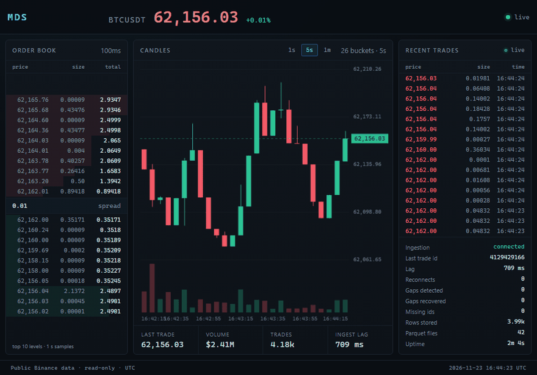

# market-data-service

[](https://github.com/IkerAbad/market-data-service/actions/workflows/ci.yml)

A read-only market data service that ingests Binance spot data in real time,
stores it as a partitioned Parquet lake and serves it through a FastAPI HTTP
API, a live WebSocket and a small browser dashboard.



The dashboard is served by the service itself. The animation above is a
60-second capture of a local live run streaming `BTCUSDT`, with the 5-second
interval selected. A still is in
[docs/dashboard.png](docs/dashboard.png). To reproduce the live view, run
`docker compose up --build`, open <http://localhost:8000>, wait until the book is
synchronized and pick `5s` in the chart header.

## What it does

- Subscribes to `<symbol>@aggTrade` and `<symbol>@depth@100ms` over one
  combined WebSocket connection.
- Normalizes every message into an explicit schema with UTC timestamps and
  `decimal128(38, 12)` prices.
- Writes trades and sampled order book snapshots to Parquet, partitioned by
  symbol and UTC date, with size- and time-based rotation.
- Repairs gaps in the trade id sequence through the public REST endpoint after
  a disconnect or a dropped frame.
- Rebuilds the local order book from a REST snapshot after every reconnect and
  whenever a diff update breaks contiguity.
- Answers latest price, OHLCV candles and ingestion status through FastAPI,
  using DuckDB over the Parquet files.
- Streams trades, candles and top-of-book updates to the dashboard over
  `/ws`.
- Exposes Prometheus metrics for throughput, lag, reconnects, gaps and storage.
- Replays a recorded JSONL file at the original event pace, with no Binance
  connection, through the same pipeline, API and dashboard.
- Starts with `docker compose up`, with the data and metrics in named volumes.

Only public endpoints are used. The service cannot place orders, does not need
API keys and never writes to the exchange.

## Quick start

```bash
git clone https://github.com/IkerAbad/market-data-service.git
cd market-data-service
docker compose up --build
```

| Service | URL |
|---|---|
| Dashboard | <http://localhost:8000> |
| OpenAPI docs | <http://localhost:8000/docs> |
| Prometheus | <http://localhost:9090> |

To ingest another symbol:

```bash
MDS_SYMBOL=ETHUSDT docker compose up --build
```

`docker compose down` keeps both volumes. `docker compose down -v` deletes the
Parquet lake and the Prometheus database.

## Replay mode

The repository ships `examples/btcusdt-5m.jsonl.gz`, a 5.5-minute BTCUSDT
recording under 5 MiB. It contains the raw `aggTrade` and `depth@100ms` frames
plus an embedded REST depth snapshot, so the replay needs no Binance connection.

After the local install:

```bash
MDS_DATA_DIR=data-replay python -m market_data_service --replay examples/btcusdt-5m.jsonl.gz
```

Open <http://localhost:8000>. The header and the tape badge show `replay`
instead of `live`. The service serves the API, the dashboard and the WebSocket
while the file is replayed. The replay runs at the original event pace by
default. `--replay-speed` accelerates it without changing the recorded event
timestamps:

```bash
MDS_DATA_DIR=data-replay python -m market_data_service \
  --replay examples/btcusdt-5m.jsonl.gz --replay-speed 10
```

Both commands use `data-replay`, so replay rows never mix with a live `data`
directory. Delete `data-replay` to start from scratch. On PowerShell, set
`$env:MDS_DATA_DIR="data-replay"` before the command.

The replay goes through the same Parquet writer, candle aggregator, API and
dashboard as the live mode. It never constructs a Binance client. A trade gap in
a recording is reported as missing because offline replay cannot call the REST
backfill.

With a locally built image:

```bash
docker build -t market-data-service .
docker run --rm -p 8000:8000 \
  -v "$PWD/examples:/replay:ro" -v mds-replay:/data \
  -e MDS_REPLAY_FILE=/replay/btcusdt-5m.jsonl.gz \
  market-data-service
```

To record another file:

```bash
python scripts/record_replay.py --duration 330 --output examples/my-5m.jsonl.gz
```

The recorder writes one metadata line with the depth snapshot, then one raw
combined-stream frame per line. Gzip keeps a 5.5-minute BTCUSDT recording under
5 MiB. The commands accept `--symbol`, `--ws-base` and `--rest-base` if you need
another public endpoint or symbol.

## Container image

Pushing a `v*` tag builds and publishes the image from the workflow:

```bash
docker pull ghcr.io/ikerabad/market-data-service:0.1.0
docker pull ghcr.io/ikerabad/market-data-service:latest
```

The tag workflow publishes the semantic version, the `major.minor` tag and
`latest` to GitHub Container Registry. The compose file builds locally; to run
the published image directly:

```bash
docker run --rm -p 8000:8000 -v market-data:/data \
  ghcr.io/ikerabad/market-data-service:0.1.0
```

Tags follow Git tags. The `0.1.0` image is the release snapshot; the replay mode
in this README is newer and is built by the local image command in the replay
section.

## Local development

Python 3.12 is required.

```powershell
py -3.12 -m venv .venv
.\.venv\Scripts\Activate.ps1
pip install -e ".[dev]"
python -m market_data_service
```

On Linux or macOS, replace the activation line with
`source .venv/bin/activate`.

By default the data goes to `./data` and the API listens on port 8000. The
service starts ingesting immediately; after a few seconds the dashboard has
candles, trades and a book.

## Repository layout

```text
src/market_data_service/
├── config.py       environment settings
├── models.py       normalized records
├── parser.py       strict Binance payload validation
├── ingestion.py    WebSocket loop, backoff, gap detection, backfill
├── replay.py       offline frame replay with an embedded depth snapshot
├── depth.py        order book state machine and resync
├── aggregator.py   in-memory OHLCV for the live feed
├── storage.py      partitioned Parquet writer and rotation
├── query.py        DuckDB analytics
├── pipeline.py     fan-out: lake, candles, WebSocket, metrics
├── api.py          REST, WebSocket and static dashboard
└── static/         HTML, CSS and JavaScript, no framework

scripts/
├── benchmark.py    measured throughput, latency, disk and memory harness
└── record_replay.py  records a JSONL(.gz) stream for offline replay

examples/
└── btcusdt-5m.jsonl.gz  5.5-minute BTCUSDT recording used by replay and tests

tests/
├── fake_exchange.py          fake WebSocket + REST exchange
├── fixtures/agg_trades.jsonl messages replayed by the fake exchange
├── test_parser.py             normalization and validation
├── test_aggregator.py         OHLCV and bucket boundaries
├── test_storage.py            partitions, schema, rotation
├── test_query.py              DuckDB queries
├── test_depth.py              snapshot anchoring and resync
├── test_api.py                HTTP and WebSocket API
├── test_ingestion.py          backoff bounds
├── test_replay.py             offline replay of the shipped recording
└── test_integration_gap.py    five-second network cut, end to end
```

## Data model

Full schema, invariants and query examples: [docs/schema.md](docs/schema.md).

```text
data/trades/symbol=BTCUSDT/date=2026-11-23/part-*.parquet
data/book/symbol=BTCUSDT/date=2026-11-23/part-*.parquet
```

| Dataset | Granularity | Key columns |
|---|---|---|
| `trades` | one aggregate trade | `trade_id`, `price`, `quantity`, `trade_time` |
| `book` | one price level per 1 s sample | `last_update_id`, `side`, `level`, `price` |

Prices and quantities are `decimal128(38, 12)`, timestamps are
`timestamp[us, UTC]`, and `quote_quantity` is derived without floats. Files are
rotated at 50 000 rows, 64 MiB or 5 seconds, whichever comes first.

## Performance

Measured on a dedicated run against the real Binance streams with the harness
in [`scripts/benchmark.py`](scripts/benchmark.py). The report is written by the
command itself:

```bash
python scripts/benchmark.py --duration 600 --symbol BTCUSDT --report docs/benchmark.md
```

The full Markdown report and the raw JSON are
[docs/benchmark.md](docs/benchmark.md) and
[docs/benchmark.json](docs/benchmark.json).

| Metric | Measured |
|---|---|
| Date (UTC) | 2026-11-23 15:19:10 |
| Measurement window | 600.0 s |
| Host | AMD Ryzen 9 5900X, 12 cores / 24 threads, 31.9 GiB RAM |
| OS / Python | Windows 11 (10.0.26300) / 3.12.10 |
| Clock offset applied | +1.352 s |
| WebSocket messages | 26,168 (43.61/s) |
| — trade messages | 20,247 (33.74/s) |
| — depth messages | 5,921 (9.87/s) |
| Trades ingested | 20,247 |
| Trades persisted, whole run | 21,340 |
| Gaps / backfilled / missing | 0 / 0 / 0 |
| Exchange → WebSocket ingest | p50 188.8 ms, p95 785.3 ms, mean 279.2 ms |
| Exchange → Parquet write | p50 3.12 s, p95 8.59 s, mean 3.20 s |
| Trade data | 1.00 MiB |
| Book data | 539.82 KiB |
| Trade bytes per row | 49.2 B |
| Disk per million trades | 46.92 MiB |
| Disk growth | 8.61 MiB/h |
| Trade files / book files | 117 / 105 |
| RSS average / peak | 106.1 / 111.2 MiB |
| CPU average | 0.016 cores (1.6% of one core) |

The throughput and ingest figures cover the 600 s window. The write-latency
histogram covers every file written by the process, including the 30 s warmup.

The latency figures are bucket-interpolated from the service's own Prometheus
histograms. The benchmark measures the host clock offset against
`GET /api/v3/time` and applies it to the service as `MDS_CLOCK_OFFSET_S`, so the
write latency uses exchange time. Disk figures are file sizes reported by
`/api/v1/status` after the final drain. The per-million figure divides by the
measured persisted trade count, and the hourly rate uses the process uptime.
The table below transcribes the generated report; `docs/benchmark.json` holds
the raw numbers.

## Cost of running

The measured consumption for one BTCUSDT stream, normalized to one hour from the
same 600 s run:

| Resource | Measured per hour |
|---|---|
| Parquet growth, trades and book | 8.61 MiB/h |
| Trades stored | 121,464/h (33.74 trades/s × 3,600) |
| WebSocket messages | 156,996/h (43.61 messages/s × 3,600) |
| CPU | 0.016 core-hours per hour (1.6% of one core) |
| Memory | 106.1 MiB average, 111.2 MiB peak |

CPU is an average level and memory is resident memory, not an hourly
accumulation. Disk and message counts are unit conversions of the measured
rates. These figures cover the `market-data-service` process only; Docker,
Prometheus and its time-series database are not included. Network traffic is not
measured per process.

No monetary price is quoted. CPU, RAM and disk prices depend on the provider,
region and commitment, and inventing one would contradict the measurement rule.
Given a provider's prices, the hourly cost is:

```text
cost/h = 0.016 × cpu_price_per_core_hour
       + 0.109 × ram_price_per_gib_hour
       + 0.0084 × disk_price_per_gib_hour
```

The RAM term uses the measured peak (111.2 MiB = 0.109 GiB) and the disk term
uses 8.61 MiB/h = 0.0084 GiB/h. The CPU term is the measured average.

## Ingestion and recovery

The trade stream is ordered by aggregate trade id. If an inbound id is not
exactly `last + 1`, the service:

1. counts the discontinuity in `mds_gaps_detected_total`,
2. buffers live trades while it requests `GET /api/v3/aggTrades?fromId=...`,
3. writes the recovered ids in order, then drains the live buffer,
4. reports any id that REST could not supply through
   `mds_trades_missing_total` instead of hiding it.

A reconnect triggers the same path, and the order book is rebuilt from a fresh
REST snapshot before it is used again. Reconnection uses exponential backoff
with equal jitter: `delay = min(cap, base * 2^attempt) / 2 + U(0, delay / 2)`.

The integration test
`tests/test_integration_gap.py::test_five_second_cut_is_backfilled_without_gaps`
proves the behavior end to end. A fake exchange replays
`tests/fixtures/agg_trades.jsonl`: it sends 20 trades, closes the socket, refuses
connections for five seconds and resumes at trade 26. Trades 21 to 25 are only
obtainable through REST. The test checks that:

- the outage lasted at least five seconds,
- five trades were recovered with `trades_backfilled == 5`,
- no id is missing,
- the Parquet lake contains exactly ids 1 to 45, without duplicates or holes.

Run only that test with:

```bash
pytest -m integration -q
```

## API

| Method | Path | Description |
|---|---|---|
| `GET` | `/api/v1/health` | Liveness, mode, ingestion and book readiness |
| `GET` | `/api/v1/price?symbol=BTCUSDT` | Latest trade |
| `GET` | `/api/v1/candles?interval=1m&limit=200` | OHLCV, intervals `1s`, `5s`, `1m` |
| `GET` | `/api/v1/book?limit=20` | Current book, or the last snapshot from Parquet |
| `GET` | `/api/v1/status` | Mode, replay progress, ingestion lag, gaps and storage |
| `GET` | `/metrics` | Prometheus exposition |
| `WS` | `/ws` | Live or replay `trade`, `candle` and `book` frames; `hello` includes the mode |

Prices in JSON are strings, never floats:

```json
{
  "symbol": "BTCUSDT",
  "trade_id": 4128923445,
  "price": "61403.57",
  "quantity": "0.00027",
  "quote_quantity": "16.5789639",
  "trade_time": "2026-11-23T13:27:57Z",
  "ingested_at": "2026-11-23T13:27:57.031Z",
  "side": "buy"
}
```

Candles are computed by DuckDB from the trade files. The live aggregator is
merged on top, so the current bucket stays fresh between Parquet flushes. A
candle's `close_time` is exclusive.

The dashboard is plain HTML, CSS and JavaScript. It opens one WebSocket, renders
candles on a canvas, updates the book and the tape in place, and reconnects on
its own with backoff. No build step, no CDN, no framework.

## Metrics

| Metric | Type | Meaning |
|---|---|---|
| `mds_ws_messages_total{stream}` | counter | Frames accepted per stream |
| `mds_ws_reconnects_total` | counter | Reconnection attempts after failures |
| `mds_ws_connected` | gauge | 1 while the socket is open |
| `mds_ingest_lag_seconds` | gauge | Local clock plus offset minus last trade event time |
| `mds_message_latency_seconds` | histogram | Arrival latency distribution |
| `mds_write_lag_seconds` | histogram | Exchange timestamp to Parquet write |
| `mds_trades_ingested_total` | counter | Trades accepted into the pipeline |
| `mds_trades_backfilled_total` | counter | Trades recovered through REST |
| `mds_trades_missing_total` | counter | Ids that could not be recovered |
| `mds_gaps_detected_total` | counter | Trade id discontinuities |
| `mds_depth_resyncs_total` | counter | Book rebuilds |
| `mds_depth_ready` | gauge | 1 when the book is synchronized |
| `mds_depth_buffered_updates` | gauge | Updates waiting for a snapshot |
| `mds_book_snapshots_total` | counter | Snapshots persisted |
| `mds_parquet_files_written` | gauge | Files written since start |
| `mds_parquet_rows_written` | gauge | Rows written since start |
| `mds_writer_buffered_rows` | gauge | Rows waiting to be flushed |

Useful PromQL:

```promql
rate(mds_ws_messages_total[1m])
rate(mds_ws_messages_total{stream="trade"}[1m])
histogram_quantile(0.95, rate(mds_message_latency_seconds_bucket[5m]))
histogram_quantile(0.95, rate(mds_write_lag_seconds_bucket[5m]))
increase(mds_trades_backfilled_total[10m])
```

## Configuration

All settings are environment variables with the `MDS_` prefix.

| Variable | Default | Description |
|---|---|---|
| `MDS_SYMBOL` | `BTCUSDT` | Binance spot symbol |
| `MDS_DATA_DIR` | `data` | Parquet lake root |
| `MDS_HOST` | `0.0.0.0` | HTTP bind address |
| `MDS_PORT` | `8000` | HTTP port |
| `MDS_DEPTH_LEVELS` | `20` | Levels per side in a persisted snapshot |
| `MDS_DEPTH_SNAPSHOT_INTERVAL_S` | `1.0` | Book sampling period |
| `MDS_FLUSH_INTERVAL_S` | `5.0` | Maximum age of buffered rows |
| `MDS_FLUSH_MAX_ROWS` | `50000` | Row threshold for rotation |
| `MDS_FLUSH_MAX_BYTES` | `67108864` | Byte threshold for rotation |
| `MDS_RECONNECT_BASE_S` | `0.5` | Initial backoff |
| `MDS_RECONNECT_MAX_S` | `30.0` | Backoff cap |
| `MDS_MAX_BACKFILL_TRADES` | `50000` | Recovery budget per gap |
| `MDS_ENABLE_INGESTION` | `true` | Disables live ingestion; replay still runs |
| `MDS_REPLAY_FILE` | unset | Replay this JSONL(.gz) instead of the live stream |
| `MDS_REPLAY_SPEED` | `1.0` | Replay pacing multiplier |
| `MDS_LOG_LEVEL` | `INFO` | Python log level |
| `MDS_CLOCK_OFFSET_S` | `0.0` | Added to host timestamps; used by the benchmark |

The compose file reads `MDS_SYMBOL`, `MDS_HTTP_PORT` and `PROMETHEUS_PORT` from
the environment or a local `.env` file. See `.env.example`.

## Tests and CI

```bash
ruff check src tests scripts
ruff format --check src tests scripts
mypy src tests scripts
pytest -q
```

The suite includes parser and aggregator unit tests, storage and DuckDB tests,
order book resync tests, API tests and the five-second recovery integration
test. `tests/test_replay.py` loads the shipped recording, starts the app with no
Binance client, replays it at high speed and checks the dashboard, price,
candles, book, status and WebSocket hello. CI runs lint, formatting, strict mypy
and the full test suite on Python 3.12, then builds the image and exercises
`docker compose up`, the dashboard, the metrics endpoint and Prometheus. A
second job clones the public repository into a fresh temporary directory and
repeats the full suite and `docker compose up` from that clone.

On a Linux machine with Docker, the clone validation can be reproduced with:

```bash
git clone https://github.com/IkerAbad/market-data-service.git "$TMPDIR/mds-clone"
cd "$TMPDIR/mds-clone"
python -m venv .venv
. .venv/bin/activate
pip install -e ".[dev]"
pytest -q
docker compose up -d --build
docker compose down -v
```

## Design decisions

**Aggregate trades instead of raw trades.** Aggregate trade ids are contiguous
and can be fetched by `fromId` from a public endpoint. That turns gap repair
into a bounded, exact operation.

**Sampled book snapshots.** The diff stream is processed at 100 ms, but writing
every delta to Parquet would produce a large, awkward dataset. The lake stores
top-20 snapshots once per second, which is enough for analytics, while the
dashboard gets the live book from memory.

**Candles derived in DuckDB.** There is one source of truth, trades. Storing
candles as a second dataset would duplicate data and eventually disagree with
it. The in-memory aggregator exists only to keep the live bucket fresh.

**Replay uses the same pipeline.** The recording contains raw frames plus one
depth snapshot. The replay runner feeds the ingestor's public frame handler at
the recorded event pace, so Parquet, candles, the API and the dashboard are the
same code paths as live. The depth snapshot is embedded to keep the mode
offline, and a replay trade gap is reported as missing instead of calling REST.

**No Celery, Kafka or Redis.** The minimum scope is one symbol per process. An
in-process queue, an asyncio pipeline and Parquet files cover it without extra
infrastructure.

**Dependencies.** FastAPI and uvicorn serve HTTP; websockets speaks the stream;
httpx performs REST backfill; pyarrow writes Parquet; duckdb reads it; pytz is
required by DuckDB to convert timezone-aware timestamps to Python objects;
prometheus-client exposes metrics; pytest, ruff, mypy and psutil are development
tools. psutil is only used by `scripts/benchmark.py`.

## Limitations

- One symbol per process. Run several instances with different `MDS_SYMBOL`
  and data directories if you need more.
- Trade ids are aggregate trade ids. The first ever aggregate trade of a symbol
  defines the baseline; there is no earlier history.
- REST backfill is bounded by `MDS_MAX_BACKFILL_TRADES` and by Binance's
  retention of aggregate trades. Very long outages can leave reported holes.
- Book history is sampled, not exhaustive: the lake does not contain every
  diff update.
- Replay is offline and finite. It cannot repair a gap in the recording, and the
  dashboard stops receiving new data when the file ends.
- The service trusts the host clock. If the host is not synchronized, set
  `MDS_CLOCK_OFFSET_S` from a measured offset or fix NTP.
- No authentication, no multi-tenant isolation, no SLA. This is a read-only
  reference service, not a trading system.

## License

MIT. Copyright (c) 2026 Iker Abad. See [LICENSE](LICENSE).
